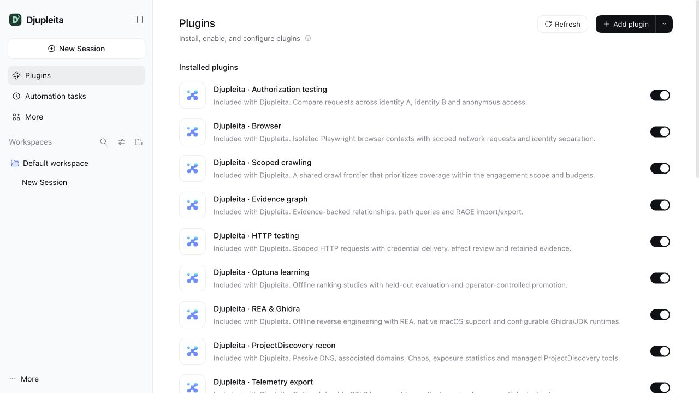
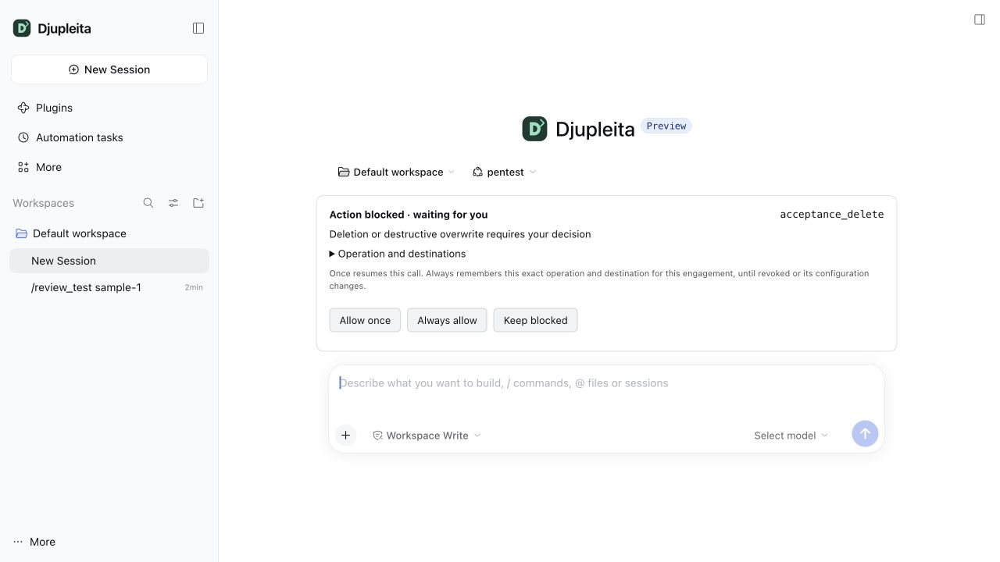
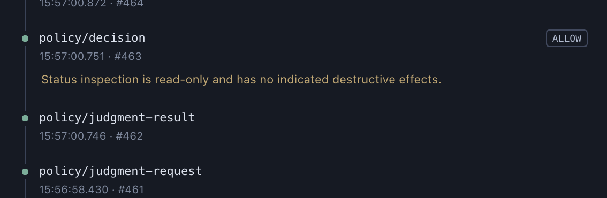

# Djupleita

A penetration-testing distribution with a macOS Electron app and a Linux web interface built on [DeepSeek Harness](https://github.com/deepseek-ai/deepseek-harness), composed from external Cordis plugins. The upstream checkout is pinned in `upstream.lock.json`. Its shared agent loop is unchanged. `patches/djupleita-branding.patch` owns the app name, welcome/menu copy and placement of installed plugin cards; `patches/djupleita-provider-trust.patch` adds captured provider endpoint metadata for the model egress plugin. `patches/djupleita-replay.patch` adds editing and replay in a new conversation, with assessment state inherited before replay starts.

The Pentest sidebar sits beside each chat and shows its trajectory, evidence graph, assessments, identities, scope/effect policy, studies, and plugin configuration. Target actions use managed adapters. Unknown DSH tools pause for an explicit operator decision that identifies their unverified destinations and effects.

See the [architecture and configuration map](docs/architecture/) for Mermaid diagrams of the components, request flow, startup, instruction loading, subagents and audit storage, plus an index of where to edit `AGENTS.md` files, prompts, configs and implementations.

**Recon beside the conversation.** Open **Pentest → Graph** to explore discovered hosts and their relationships while reading the agent's results. Discovery records host candidates and the evidence linking them. These observations do not establish that a host is live, verify a vulnerability, or expand the authorized target scope.

## Run

| Platform | Interface | Installation |
| --- | --- | --- |
| Linux x64 / arm64 (glibc) | Browser with a Linux backend | [Linux install](#linux-browser-interface) |
| macOS 15+ | Electron desktop; browser also available | [macOS install](#macos-desktop) |

Native Windows is unsupported.

### Linux (browser interface)

Use Debian 12 / Ubuntu 22.04 or newer and a regular Linux user account. Install the full **Node 24 LTS distribution (24.9+) with npm and development headers**, using the [official Node downloads](https://nodejs.org/en/download). The native build needs `<Node prefix>/include/node/node_api.h`; copying only the `node` executable is insufficient. The managed Linux tools support glibc x64 and arm64; Alpine/musl is outside this setup.

First install the system packages and check that this user can create worker sandboxes:

```sh
sudo apt-get update
sudo apt-get install -y git ca-certificates build-essential bubblewrap curl unzip zip \
  python3 python3-venv libsecret-tools dbus-user-session gnome-keyring
node --version                         # Must be 24.9 or newer; Node 24 LTS is tested.
npm install --global pnpm@10.32.1
/usr/bin/bwrap --unshare-all --ro-bind / / -- /bin/true
```

The Bubblewrap check must exit successfully before continuing. On Ubuntu 24.04, `Permission denied` or `Operation not permitted` can mean a missing application-specific AppArmor permission: follow [Bubblewrap on Ubuntu 24.04](docs/linux.md#bubblewrap-on-ubuntu-2404). Restricted containers may also prohibit the required namespaces; a normal Linux VM is the more straightforward test environment.

Clone and build on Linux, then install the browser and common tools:

```sh
git clone https://github.com/NorseStar-Security/djupleita.git
cd djupleita
pnpm bootstrap
npx --yes pnpm@11.28.5 --dir vendor/deepseek-harness install --frozen-lockfile --ignore-scripts
pnpm install --frozen-lockfile
pnpm build:harness
pnpm build
node packages/browser/node_modules/playwright/cli.js install-deps chromium
pnpm setup:tools --only browser
pnpm setup:tools --only recon
pnpm setup:tools --only ffuf
pnpm setup:tools --only rea
pnpm setup:tools --only learning
DSH_PENTEST_PORT=19876 pnpm web
```

Use `sudo` for system package installation; run the build, tool setup and app as your regular user. Playwright's `install-deps` may request sudo for its system libraries. The first install downloads packages, Chromium and tool archives, so allow several gigabytes of free disk and several minutes. The distribution uses pnpm 10.32.1; its pinned harness uses pnpm 11.28.5 through the explicit `npx` command above. Keep both lockfiles intact. Linux does not need Electron installation or `pnpm build:keychain`.

Open the **full authenticated URL printed at startup**, including its token. The address stays on `127.0.0.1`; opening the bare address in a new browser session can return `401`. Configure your provider/API key in the fresh profile, choose a Linux workspace, then configure authorized target scope. A new checkout has its own `.pentest/home` and does not inherit another installation's credentials. Keep `.pentest/` private. Contributors should also install the scanner/hooks and provision private reference rules as described in [SECURITY.md](SECURITY.md).

For a Linux server or a Linux VM on your Mac, run the app there and open an SSH tunnel from the computer running your browser:

```sh
ssh -N -L 127.0.0.1:19876:127.0.0.1:19876 user@linux.example.test
```

Open the startup URL through that tunnel. Workspaces, tools and files are on Linux. Running `pnpm web` directly on macOS exercises the macOS adapters; use a Linux VM to test the Linux adapters. This is an authenticated, single-user interface; keep it on loopback.

**Common Linux setup problems**

| What you see | What to do |
| --- | --- |
| `Node-API headers missing`, `cc: not found`, or an unsupported Node version | Install a complete Node 24 distribution, including its matching `include/node` directory, and `build-essential`. See [Node checks](docs/linux.md#node-and-package-managers). |
| pnpm version/lockfile errors, or npm `EACCES` | Use the two package-manager versions shown above and a user-owned Node installation. Repeat the failed install command with its lockfile preserved; do not run the app as root to work around npm permissions. |
| Tool installation says only macOS arm64/x64 is supported | The backend predates the Linux adapters. Update the source, rebuild with `pnpm build`, and stop and restart `pnpm web` before retrying. See [tool setup](#first-run-tool-setup). |
| Bubblewrap reports UID-map, namespace, loopback or `/proc` permission errors | Check [Ubuntu AppArmor and container restrictions](docs/linux.md#isolation). Install the scoped Bubblewrap permission where needed; keep worker isolation enabled. |
| Chromium executable missing or shared-library errors | Run `install-deps chromium`, then `pnpm setup:tools --only browser`. After terminal setup while the app is running, select **Load local setup** in **Pentest → Plugins**. |
| `SECRET_SERVICE_UNAVAILABLE`, a locked keyring, or no D-Bus session | Identity credentials need `secret-tool` and an unlocked encrypted keyring in the app's user session. Headless/SSH setup is [documented here](docs/linux.md#identity-credentials). The web UI and model-provider setup can run before identity storage is configured. |
| `401` in the browser, or the remote page does not open | Use the full current startup URL; for a remote host, keep the SSH tunnel open and use matching ports. Restarting the app changes the startup token. |
| First-run API-key prompt or **Choose workspace to start** | Configure a model provider and select a workspace on the Linux host. Browser access from your Mac does not automatically expose Mac files or import Mac credentials. |
| **Action blocked · waiting for you**, or tools still shown as missing | New scope starts empty. Apply authorized targets in **Pentest → Policy**, review the blocked operation, and configure missing dependencies in **Plugins**. REA/Ghidra and learning need [additional setup](docs/linux.md#optional-tools). |
| Port already in use, or engagement writer-lock error | Stop the existing app process or select a free `DSH_PENTEST_PORT`. Use one writer per engagement. Remove a stale writer lock only after confirming its recorded process has exited. |

See the [Linux guide](docs/linux.md) for sandbox details, keyring sessions, optional tools and validation commands.

### macOS (desktop)

Requires macOS 15+, Node 24.9+ for this workspace, pnpm, and Apple's Command Line Tools. REA has its own stricter Node requirements, described below.

Clone [NorseStar-Security/djupleita](https://github.com/NorseStar-Security/djupleita) and run these commands from its root. The repository now contains this distribution; `upstream.lock.json` and the three reviewed patches reproduce its underlying harness.

```sh
git clone https://github.com/NorseStar-Security/djupleita.git
cd djupleita
node scripts/security/install.mjs
node scripts/security/hooks.mjs
pnpm bootstrap
npx --yes pnpm@11.28.5 --dir vendor/deepseek-harness install --frozen-lockfile --ignore-scripts
node vendor/deepseek-harness/node_modules/electron/install.js
pnpm build:harness
pnpm install --ignore-scripts
pnpm build:keychain
pnpm build
pnpm setup:tools --only recon
pnpm desktop
```

The upstream package manager may provision its declared Node/pnpm versions. The first desktop launch also prepares DSH's bundled dependency runtime. This is a development app; a signed/notarized installer is not produced by these commands.

### Configure the app (both platforms)

Open the right sidebar and select **Pentest**. Configure a model and its credential through **Models** settings. Its effective API endpoint is allowed automatically, including custom and local providers. Changing engagement scope does not require another provider approval. New engagements load the course targets from issue 13 with **Scope management OFF**. Students can enable the switch in **Policy** and select **Apply scope and policy** to enforce the boundary. Existing engagements keep their saved configuration. See [scope and destination allowances](docs/scope.md) and [normal modes with Pentest tools](docs/modes.md).

Pentest extends **Standard**, **Creator**, **PTC** and **Minimal** while preserving each mode's tools, commands and skills. The **Pentest** mode is an alias of extended Standard. Ordinary file search, reading, shell and editing tools remain available; PTC exposes both normal and Pentest tools through its generated SDK. Children inherit the selected composition and engagement policy. Profile upgrades preserve saved mode choices, provider settings and disabled plugins.

In **Policy**, replace the domain in the populated target-and-exclusion draft, review its preview, then select **Apply scope and policy**. The example allows the apex and subdomains over HTTP/HTTPS on ports 80/443, with all paths, and excludes the named subtree. It stays inactive until applied. Existing scope is preserved, and the working example remains available as a reference.

The main **Plugins** page lists thirteen managed **Djupleita** bundles under **Installed plugins**, before the upstream settings and experimental plugins. Each card says **Included with Djupleita**, exposes an enable switch, and opens its configuration and engagement controls. **Djupleita · Engagement and identities** provides the required scope, effect-review and secure credential settings. Disabling an optional bundle removes its tools while required enforcement remains active. New bundles are added once when an existing profile upgrades; later launches preserve enable/disable choices.

The **Assessment workflow** and **Finding validation** bundles add five assessment skills, durable bounded runs, readiness checks, coverage and leads, read-only object authorization proofs, owner review and redacted report export. Start with the [assessment workflow guide](docs/assessment-workflow.md). Other finding families remain hypotheses until a dedicated validator is available; reports include only current deterministic proofs accepted by the owner.

User messages offer **Edit and replay** to retry revised instructions in a new chat from that point. Original attachments are retained. Both branches share the engagement and assessment limits; see [Conversation replay](docs/conversation-replay.md).

Startup refreshes distribution-owned profile rows while retaining provider settings, custom rows, comments and Cordis expressions saved by DSH. Before changing the profile patch, it saves a private `cordis.patch.yml.pre-launch.bak`; malformed YAML stops preparation without replacing the file.

Djupleita always uses this checkout's `.pentest/home`, separate from the original Harness app's `~/.dsh`. Model keys live in `.pentest/home/.credentials.yaml`; model definitions live in `profiles/desktop/cordis.patch.yml` (desktop) and `profiles/pentest/cordis.patch.yml` (web preview) under that home. Switching between the original app and Djupleita can therefore show different providers. The empty key input in Models settings is for replacing a key; **API key configured** means a saved key is present.

To recover a named API-key provider from an existing Harness desktop installation:

```sh
pnpm import:provider --from-home "$HOME/.dsh" --provider adrian-spark
```

Use the exact provider ID saved in the source desktop profile. The command imports only that definition and its saved key into both Djupleita profiles, preserves existing settings and credentials, and refuses conflicting replacements. Private backups are kept in `.pentest/home/provider-import-backups`. Repeating the same import makes no changes. Restart Djupleita afterwards; importing does not contact the provider or change engagement scope. OAuth sign-ins, browser grants and environment-only keys are not migrated.

`configs/distribution.json` describes the distribution's bundles. Internal `@dsh-pentest/*` service names, `pentest_*` tool names and `.pentest` data paths remain stable so existing engagement data and integrations continue to work.

`pnpm web` runs the browser interface using the same plugins on macOS and Linux. Run one desktop or web process per engagement. A second writer is refused. After an unclean shutdown, inspect `.pentest/engagements/<id>/writer.lock`, verify its PID has exited, and remove that stale lock before restarting.

The default engagement is `.pentest/engagement.json`. Set `DSH_PENTEST_ENGAGEMENT` to another JSON file to select a different engagement. Each engagement gets its own graph, identity metadata, trajectories, evidence, browser state, worker directories, studies and telemetry outbox.

The pentest preset includes DSH's automatic context compaction. Before each model step, it checks the selected model's declared context capacity and reserved output. At 70% of the window, or when only 8,192 tokens remain after reserving output, it first shortens oversized tool results in the model's context, then summarizes older history if needed. Provider-reported context overflow can trigger one recovery retry. The original events remain in the session log and trajectory UI. `/compact` requests a manual summary while the chat is idle. These settings live in `configs/pentest-preset.json`; custom models need accurate context-capacity metadata for proactive checks.

The same preset exposes Harness's **Subagent** plugin: `subagent` starts a fresh child, `subagent_fork` starts one with inherited conversation history, and `send_message`, `interrupt_agent` and `list_agents` control children. Children inherit the pentest preset and engagement enforcement; delegation never grants target scope or bypasses effect review. The host defaults to eight active children and one delegation level. Child model selection follows the session's authorized routes, discoverable through `list_subagent_models`. Completion notices wake the parent for another turn, and completed local children can receive follow-up work. Subagent chats and their trajectories remain available in the session hierarchy.

Use `/goal <objective>` in the chat composer for work that should continue across turns. The composed Goal plugins expose `create_goal`, `get_goal` and `update_goal`, while the host's goal driver starts subsequent rounds after the agent and its progressing children settle. `/goal` shows progress, `/goal pause` stops continuation and `/goal resume` rearms it. Completion, blocking, cancellation, errors or the round cap stop automatic progress. After restarting or restoring a chat, resume explicitly with `/goal resume`; work does not run while the app is closed. Adding these preset entries to an existing installation preserves saved model settings; restart the app to replace any already-running agent's retained preset revision.

`pentest_status` returns engagement and dependency summaries, counts and tool inventory. Its `availableTools` lists the complete catalog callable by the current agent, including Harness controls; `plugins` lists pentest effect adapters and is not the complete catalog. `pentest_trajectory` returns event metadata in pages of 20 (maximum 50); pass `before: nextBefore` for an older page, or `eventSeq` for a payload preview capped at 4,096 bytes. Full trajectory payloads remain available beside the chat and in local logs. Status and trajectory inspection never embed the full archive back into model context.

## Plugins

**Everything is a plugin.** The main **Plugins** page identifies the bundles included with Djupleita. Open a bundle to configure it, or use its switch to enable or disable optional capabilities.



| Plugin | Implemented behavior |
| --- | --- |
| Engagement / scope | Host wildcards, schemes, ports, paths, exclusions, explicit private network grants, and separate target/intelligence/model/telemetry destinations. Shared request, duration, rate, concurrency, depth and byte limits. |
| Effect policy | Trusted local reads use deterministic descriptors without a model call, subject to explicit rules and existing access permissions. Ambiguous effects use the selected model or optional TypeSafe Jev. Deletes, overwrites, unknown effects and explicit rule denials pause for an inline owner decision. |
| Subagents / goals | Harness plugins exposed in the pentest preset: fresh/forked children, messages and interruption, child completion wake-ups, and durable `/goal` objectives with automatic rounds and pause/resume controls. Every child retains engagement enforcement. |
| HTTP | DNS-pinned requests, checked redirects, host-bound identity delivery, bounded responses and retained redacted evidence. |
| Passive recon | DNS A/AAAA/CNAME/MX/NS/TXT/CAA through a scoped DoH service; ProjectDiscovery associated domains, Chaos subdomains and breach-exposure statistics. |
| ProjectDiscovery CLI | Typed adapters for subfinder, asnmap, uncover, httpx and Katana. Pinned executable hashes; private proxy; macOS/Linux process, file and network confinement. Active httpx/Katana operations are explicit. |
| [ffuf fuzzing](packages/plugin-ffuf/README.md) | URL path/query fuzzing, named or inline wordlists, status/size/word/line filters and identity references. Each generated request crosses the HTTP broker; matches feed the evidence graph and scoped crawl frontier. |
| REA | Pinned `rea-agents@6.8.0` MCP server, dynamic catalog, bounded calls, offline analysis workspaces on macOS/Linux, native macOS ownership helper, configurable Ghidra and JDK. |
| Browser | Playwright headless Chromium, separate chat/identity contexts, navigate/snapshot/click/fill, brokered HTTP, blocked direct browser sockets, WebSockets and service workers. |
| Crawl | Shared frontier fed by browser, HTTP, REA and recon observations. Identity-aware deduplication, endpoint-template limits, depth limits, coverage saturation and ranking. Discovery never adds scope. |
| Graph | SQLite evidence graph, observed/inferred/verified relationships, bounded path queries and RAGE 0.1 NDJSON import/export. Discovery edges are not access capabilities. |
| Identities / authz | Keychain/Secret Service bearer, Basic, header and browser-storage identities. A/B/anonymous read replays retain separate evidence and produce authorization candidates. Trusted ownership assertions can verify findings. |
| Trajectories / export | Hash-linked, fsynced, redacted chat/session/tool/judgment events. Optional OTLP/HTTP JSON logs with stable chat trace IDs, durable destination cursors and retry outbox. |
| Learning | Optuna crawl ranking and GEPA authz procedures, isolated datasets, held-out evaluation, model trajectories, bounded calls and cancellation. Explicit owner promotion; persistent procedures can be disabled. |

The [Neo recon page](https://docs.neo.projectdiscovery.io/platform/agents/discovery/recon-agent) describes passive capabilities rather than a public implementation of its proprietary agent. This project implements those capabilities using public APIs and the named open-source adapters. It does not run the proprietary Neo agent.

## Scope and credentials

A scope rule looks like this:

```json
{
  "host": "*.example.com",
  "schemes": ["https"],
  "ports": [443],
  "pathPrefixes": ["/"],
  "allowPrivateAddresses": false
}
```

`*.example.com` excludes the apex; add `example.com` explicitly if authorized. Exclusions take precedence in normal scope rules. Private/internal targets require explicit network CIDRs and private-address permission or an exact owner-reviewed exception. DNS answers are validated and pinned for the connection. An effect approval does not grant network access. Out-of-scope destinations and restricted DNS addresses require separate explicit owner decisions, bound to the exact URL/purpose and resolved address respectively.

When a policy, destination, restricted network address, missing tool adapter, or downstream harness approval blocks a live operation, an **Action blocked · waiting for you** card appears above the chat input. **Allow once** resumes that waiting call; **Always allow** also saves an engagement-local allowance for matching tool inputs, check category and destinations. Redirects and changed inputs still receive their own checks. The card shows the reason and redacted operation details. **Keep blocked** rejects it. A cancelled or expired call cannot be revived by a late answer.



**Resolve a blocked action in the chat.** This local acceptance fixture demonstrates a deletion review. Expand **Operation and destinations** to inspect the request, then allow it once, save a matching allowance, or keep it blocked.

**Pending approvals** above the chat input is an engagement-wide inbox: it includes requests from every chat and subagent, even children you have never opened. Its count stays visible when collapsed; expand it to see requests grouped by agent and resolve each with **Allow once**, **Always allow**, or **Keep blocked**. Each decision resumes only the requesting call and is recorded in that agent's trajectory. Saved allowances retain their existing exact-operation scope and can be revoked from the same interface.

Saved allowances can be inspected and **Revoked** in the same chat, or in **Pentest → Policy**. They are stored privately in the engagement's `grants.json`; raw-input hashes prevent distinct redacted inputs from sharing permission. Scope, policy and plugin configuration revisions invalidate matching grants. Requests, owner decisions and grant use/revocation are recorded in trajectories. Only the authenticated owner connection exposes decision endpoints; model tools cannot create allowances. Missing credentials, unavailable dependencies, malformed inputs and storage failures still need their underlying problem fixed.



**See why an action was allowed or blocked.** Open **Pentest → Trajectory** to follow policy judgment requests, results and decisions alongside tool activity. The example above records an **ALLOW** decision and its reason for a read-only status inspection. Select an event to inspect its recorded details.

The desktop displays 100 events at a time. **Older events** opens previous pages; **Latest events** returns to live updates. Event data larger than 4 KiB appears as a labeled preview; selecting it loads the original redacted data in 16,384-character pages. The complete hash-linked archive stays on disk, and its entire chain is verified before a page is returned. Unchanged pages are cached. Closing a view releases its snapshot and stops its polling when no other view observes that chat.

The graph displays up to 150 nodes and 500 relationships between those nodes per page, with total engagement counts above it. Use **Previous page** and **Next page** to browse nodes. Cross-page relationships remain in the saved graph and its full export. These bounds prevent growing trajectories and recon graphs from exhausting the Electron renderer. See the [October 2026 crash investigation](docs/crash-investigation-2026-10-31.md).

Configured model adapters authorize their captured API roots, including explicitly declared auxiliary roots, with exact scheme, host, port and path boundaries; this permission does not authorize pentest traffic to the provider. DNS answers remain validated and pinned, and redirects are refused. Explicitly configured API roots can resolve to private gateway addresses. Loopback access is automatic only for explicitly configured loopback endpoints; other names resolving to loopback still require network review. Put auxiliary API/collector hosts under the matching `scope.services` purpose: `api.typesafe.ai` for Jev, `dns.google` for the default DoH resolver, `api.projectdiscovery.io` and `dns.projectdiscovery.io` for PDCP/Chaos, and your collector host for telemetry. Manual `scope.services.model` rules remain available for auxiliary model services and adapters that do not report their endpoints. CLI passive providers also need their intelligence destinations allowed, such as `crt.sh` for the default subfinder source.

For a blocked destination, **Always allow all calls to HOST** saves an allowance for that exact hostname or IP across tools, chats, subagents, paths, methods and ports in the engagement. It survives restarts and scope edits until revoked. Add entries directly under **Manage destination allowances** and revoke them under **Saved allowances**. This explicit owner override can expand network scope, including an excluded host; action-effect and filesystem decisions remain separate. **Allow once** and **Always allow** keep their narrower operation-specific meaning.

Trusted local inspection, including current-directory viewing, status and trajectory reads, needs no model judgment. Review cards identify the remaining access, destination or effect restriction. Human approval waits do not consume the judge's execution timeout, and transport failures retain their actual error. Automatic descriptor decisions and owner overrides are recorded in the trajectory.

Add credentials in **Identities** and pass only their IDs to tools. Secrets are stored in macOS Keychain or Linux Secret Service; identity JSON contains metadata and references. Host bindings are independent from engagement scope. Service keys can use a headers identity, for example `X-API-Key` for PDCP or an `Authorization` header for Chaos. Keep secrets out of chats and plugin JSON.

Browser field entry is treated as a reversible modification and evaluated by the selected judge. Clicks request review by default because a selector alone does not establish the resulting effect. Operator policy rules can specialize this behavior; each resulting HTTP request still goes through scope and effect checks.

To select Jev, add a bearer identity bound to `api.typesafe.ai`, allow that host under model services, and include this in the policy JSON:

```json
"judge": {
  "kind": "jev",
  "model": "jev-latest",
  "identityId": "<identity UUID>",
  "fallback": true
}
```

The [TypeSafe adapter](https://docs.typesafe.ai/introduction/quickstart) asks separate deletion, irreversibility and disruption questions. Noul probabilities are converted into an explicit conservative decision margin; that margin is not a calibrated confidence score. Thresholds and host rules remain local policy.

## First-run tool setup

Plugin code ships with Djupleita; executable dependencies are managed downloads. A new chat shows a setup card when recon tools, ffuf or REA are missing. Select **Install recon tools**, **Install ffuf** or **Install REA** there, or open the relevant plugin's **Tool setup** (also available in **Pentest → Plugins**). Recon setup installs and activates subfinder, asnmap, uncover, httpx and Katana without manually editing binary paths. After installation, retry the failed call. Applying configuration cancels in-flight tool requests.

Install only the toolchains needed for the engagement. **Hide setup reminder** dismisses the compact card across refreshes and restarts, including after a partial installation. Full setup stays available in **Plugins**, where **Show setup reminder** restores it. A requested tool still reports its own missing prerequisites.

**Install and verify dependencies from the UI.** **Install recon tools** downloads the pinned releases and checks their hashes. **Install ffuf** and **Install REA** also run on Linux x64/arm64 and macOS x64/arm64. The backend chooses its own operating system and architecture, regardless of the computer running the browser. **Load local setup** imports an existing installation; **Check tools** refreshes readiness. A **Verified** label confirms executable and SHA-256 checks.

If an existing Linux build says managed tools support only macOS, update to a revision containing the Linux adapters, run `pnpm install --frozen-lockfile` and `pnpm build`, then stop and restart `pnpm web`. A running backend keeps its loaded installer code until restart. Re-run the install action; existing verified downloads are reused. Keep the private `.pentest/` directory and load local setup afterwards.

From the project directory, after `pnpm build`, use:

```sh
pnpm setup:tools --only recon
pnpm setup:tools --only ffuf
pnpm setup:tools --only browser
pnpm setup:tools --only rea
pnpm setup:tools --only learning
```

`pnpm setup:tools` installs all five groups. Installations stay under `.pentest/toolchains`; paths and executable hashes are written to `.pentest/tooling.json`. Select **Load local setup** in the UI after a terminal installation to apply it to an existing engagement. **Check tools** refreshes readiness checks. Recon and ffuf are marked Verified only after checking executable hashes. Other dependencies are marked Configured when files are present; REA's doctor checks runtime compatibility. These operations do not scan a target or use a model provider. No sudo, global binary installation, or changes to other coding clients are required.

For URL fuzzing, open **Plugins → ffuf fuzzing → Tool setup → Install ffuf**. `configs/ffuf.lock.json` pins the official ffuf 2.3.0 archives and SHA-256 values for macOS/Linux arm64 and x64. The `pentest_ffuf` tool accepts a URL such as `https://app.example.test/FUZZ`, inline `words` or a configured wordlist ID, response filters and an optional `identityId`. See the [ffuf plugin guide](packages/plugin-ffuf/README.md) for examples and supported controls. Its private gateway checks each expanded URL through the HTTP broker, including path scope, deletion review and per-request budgets. Matching uses redacted responses; redirects, vhost fuzzing, recursion and external mutator commands are not exposed.

**ffuf is installed and checked from the same interface.** Its **Verified** label confirms the local executable matches its configured SHA-256. Fuzzing requests still pass through engagement scope, budgets and inline action review.

`configs/recon-tools.lock.json` pins official GitHub macOS/Linux arm64 and x64 archives: subfinder 2.17.0, asnmap 1.1.1, uncover 1.2.1, httpx 1.12.0 and Katana 1.8.0. Archive SHA-256 values are checked before extraction, license notices are retained, and every execution checks the configured binary hash. Re-running setup reuses verified installations; checksum mismatches fail closed. The recon installer activates these managed versions, replacing existing mappings for the five tools. Updating releases requires updating the lockfile and reviewing the matching official release checksums.

REA remains pinned to `rea-agents@6.8.0`; its installer never runs `rea setup`. **Install REA** also installs a checksum-pinned Node 24.22.1 runtime for the host's macOS/Linux architecture; `configs/rea-node.lock.json` records official sources and hashes. An explicit `--rea-node /absolute/node` override must satisfy REA's version requirements. Chromium comes from the pinned Playwright package. `--python /absolute/python3`, `--analysis-root /absolute/artifacts`, `--ghidra /absolute/ghidra` and `--java-home /absolute/jdk/Contents/Home` select local runtimes. Linux defaults to `/usr/bin/python3`; macOS uses DSH's prepared desktop Python runtime. Ghidra and its JDK are optional manual downloads, described below and in the setup panel.

`configs/plugins.example.json` documents the configuration shape. Saved engagement settings take precedence on startup, with newly installed recon tools filling missing mappings. **Load local setup** explicitly imports the current installation into an existing engagement. The model cannot install dependencies, edit owner settings or promote a study.

To use a custom ProjectDiscovery executable instead, configure `{ "path": "/absolute/binary", "sha256": "<64 hex characters>" }` under `recon.binaries`. Obtain and verify your chosen release, then calculate the executable hash with `shasum -a 256 /absolute/binary`. `pentest_recon_doctor` verifies the configured hashes. Provider configuration is a private JSON object of strings/string arrays, accepted by the tools as a YAML subset; set its absolute path as `recon.providerConfig`. Values are registered for redaction before execution. Arbitrary flags and shell commands are not model inputs.

### REA and Ghidra on macOS

REA 6.8 declares Node `^22.23.4 || ^24.22.1 || >=26.12.1`. **Plugins → REA & Ghidra → Tool setup → Install REA** prepares a supported local runtime. **Check tools** marks an unsupported Node executable as **Needs setup**. `pentest_rea_doctor` distinguishes built-in artifact inventory from native engine readiness. With Ghidra configured, it checks that selected provider; missing unrelated engines and external CLI skills are informational. This embedded integration does not require global REA skill registration.

**Inspect local artifacts from the same plugin interface.** The setup panel shows runtime readiness and the selected input roots. **Configured** checks local prerequisites; `pentest_rea_doctor` performs native engine diagnostics.

The adapter selects Command Line Tools directly and keeps Swift caches and Unix sockets in private short paths. This handles macOS socket length limits and avoids requiring an accepted full-Xcode license for its ownership helper. It resolves the selected JDK's linked native libraries individually, including Homebrew dependencies. Ghidra is an optional local prerequisite: configure the extracted installation and a host-native JDK. REA's [installation guide](https://github.com/morluto/rea/blob/main/docs/installation.md) documents Ghidra 12.1.4 with JDK 21; Ghidra 12.2 needs JDK 25. On Apple silicon, ensure the Ghidra installation includes `Ghidra/Features/Decompiler/os/mac_arm_64/decompile`; Intel uses `mac_x86_64`. Build the matching native decompiler when the distribution lacks it. The plugin leaves Gatekeeper and system security settings intact.

Search `pentest_rea_catalog` with `query`, then request `tool` by exact name for its input schema before invoking `pentest_rea`. Results are paged and omit output schemas; large input schemas support focused `schemaPath` queries. For DMG/archive inventory, call the advertised `open_binary` with `path`, then `inspect_artifact` with `detail: "summary"`. That workflow does not need Ghidra and uses a read-only macOS mount. See the [REA plugin guide](packages/plugin-rea/README.md) for the workflow and native decompiler build commands. Tool annotations are descriptive; the local effect adapter remains authoritative. Unknown tools request review. Configure explicit read roots for analysis inputs; worker writes stay in its owned workspace. Dynamic UI/debugger operations may need additional platform capabilities and remain confined by the same worker policy.

### Learning and telemetry

The included **Optuna learning** plugin now offers two backends in Studies. **Optuna** tunes crawl-ranking weights from labelled candidates; **GEPA** revises an authorization-testing procedure from recorded model outputs and fixed evaluator feedback. Both retain dataset hashes, separate train/validation/test evidence, reports, trajectories and explicit owner promotion. Scope, credentials, budgets and approval rules are outside the search space.

Use [12 synthetic examples](configs/datasets/shop-authz-procedure.json) to improve the agent's checklist, compare the old and new instructions, check fresh examples kept aside, and use the checklist in the next chat. The [dataset guide](configs/datasets/shop-authz-procedure.md) documents expected answers, scoring and budgets.

Run `pnpm setup:tools --only learning`, then load local setup in the plugin to install pinned Optuna 5.0.0 and GEPA 0.1.4. GEPA uses the selected chat model for task evaluation and reflection, with provider charges, bounded calls, cancellation and no target requests. Python receives no API keys or assessment-tool access. Review case feedback and held-out results before **Promote procedure**. Promotion adds advisory context to future agent requests while this plugin is enabled, survives restart, and can be revoked with **Disable procedure**.

Optuna's [18-row ranking dataset](configs/datasets/shop-authz-ranking.json) and [guide](configs/datasets/shop-authz-ranking.md) remain available for improving endpoint selection under a two-request budget. `configs/datasets/lab-ranking.json` remains a minimal acceptance fixture. Ranking efficiency and procedure correctness are different objectives; these examples are not a comparative backend benchmark. Validate any learned change on independent labelled applications and authorized live tests.

For OTLP logs, configure `telemetry.enabled`, the full `/v1/logs` endpoint, and an optional host-bound identity ID. Allow the collector under telemetry service scope. The exporter is off by default. Export failures retain local trajectories and queued payloads; exhausted retries are retained for inspection. Use a collector or a vendor's OTLP/HTTP JSON endpoint. No hosted Logfire or Jev account was used in acceptance tests.

**Course audit streaming.** Pedram Amini's Cloudflare receiver and live instructor board are preserved in [course/audit-stream](course/audit-stream/README.md), including his course tokens, seat listing, and operator publishing route. Set `telemetry.courseAudit.sourceId` to enable receiver-compatible, digest-verified records with reasoning when the model returns it, ordered fragment delivery, retry recovery, and duplicate suppression. This explicit opt-in exports redacted trajectory records from chats and subagents. The course guide covers scoped credentials, deployment, and the distinction between this in-process exporter and an instructor-isolated collector.

## Repository security

[Secret protection](SECURITY.md) combines local pre-commit/pre-push hooks, a checksum-pinned Gitleaks scanner, CI checks with synthetic-secret negative controls, and GitHub secret-scanning push protection. Enable the hooks in each clone using the two setup commands above. Private `.pentest` state, credentials, runtime screenshots and tool downloads are excluded from version control and rejected by the path guard if staged forcibly. A successful scan is not a guarantee that every possible secret format is recognizable; review outgoing files too.

## Verification and limits

```sh
pnpm check
pnpm build
DSH_TEST_KEYCHAIN=1 \
DSH_TEST_REA_ROOT="$PWD/.pentest/toolchains/rea/node_modules/rea-agents" \
DSH_TEST_REA_NODE="$PWD/.pentest/toolchains/rea-node/24.22.1/darwin-arm64/bin/node" \
DSH_TEST_OPTUNA_PYTHON="$PWD/.pentest/toolchains/optuna/bin/python" \
DSH_TEST_FFUF="$PWD/.pentest/toolchains/ffuf/2.3.0/darwin-arm64/ffuf" \
pnpm test
```

Install Chromium with `pnpm setup:tools --only browser`, then **Load local setup**. Browser/worker tests run on macOS and Linux with their respective sandbox backend. Optional REA/Optuna/GEPA/native secure-store smoke tests run when their environment variables are set. Tests use local fixtures and generated credentials. They do not scan an external target.

CI builds and tests both macOS and Linux. After building the harness and installing Playwright Chromium, `DSH_TEST_WEB_UI=1 pnpm exec vitest run tests/web-issues.test.ts` checks authenticated web scope editing, destination approvals and setup controls. Mode fixtures compare upstream catalogs, invoke native file tools and execute both normal and Pentest tools through PTC; replay fixtures check inherited assessment membership.

For the real confined Ghidra decompile test, also set `DSH_TEST_GHIDRA` to its installation and `DSH_TEST_JAVA_HOME` to the selected JDK home. Adjust the managed Node architecture to `darwin-x64` on Intel. The test compiles a tiny local Mach-O fixture, imports it and checks its decompiled return value.

Current material limits:

- The browser defaults to the Playwright headless shell. Headed Chrome can require additional OS integration; keep `headless: true` for the tested confinement path.
- CLI HTTPS proxies can inspect the destination host but not paths inside TLS. They require whole-host path scope. Their budgets count tunnels; CLI rate/depth/output/deadline limits provide additional bounds. Direct UDP/DNS and raw scans are blocked, so tools that insist on bypassing the HTTP proxy can fail closed. Use the passive DNS API or brokered HTTP/browser crawler for those cases.
- Model fetch transport is scoped and DNS-pinned for fetch-based DSH adapters. A new provider that uses another transport needs an explicit adapter. Plugin code and operator-selected executables are trusted extensions; this is not a sandbox for arbitrary malicious plugins.
- A/B automation currently replays read methods. Mutating authorization tests use individually reviewed HTTP/browser actions; automatic scenario reset/cleanup is not implemented.
- Authorization matches are candidates until ownership/sensitivity is established. RAGE uses open `dsh` types and preserves internal distinctions in `x-dsh` extensions; it does not implement RAGE's cloud collection corpus or derivation engine.
- Real browser, Keychain, REA MCP/native helper, confined Ghidra 12.1.4 decompilation and Optuna workers were tested on Apple silicon. Intel Mac, ProjectDiscovery CLI combinations and authenticated PDCP/Jev/hosted-collector calls still require environment-specific validation.
- Linux x64 workers, Chromium A/B contexts, Secret Service, REA MCP, ffuf, Optuna and owner approval were tested with local fixtures. On native Linux arm64, the harness/distribution build, authenticated web install buttons, all five recon binaries in offline workers, brokered ffuf/Chromium, REA MCP and Optuna passed. Linux Ghidra decompilation still needs environment-specific validation.

The code is split into `packages/*`; `packages/dsh-plugin` composes their lifetimes and registers DSH tools, and `packages/ui` contributes the sidebar and inline chat reviews. Upstream and generated dependencies are ignored. `.pentest` contains private local data and should not be committed.

## Authors and course

Djupleita was named by Pedram Amini and Adrian Wood for **SEC590: Autonomous Penetration Testing: Build, Validate, and Supervise**. The project lives under [NorseStar Security](https://github.com/NorseStar-Security). [Course information](https://sec590.norsestarsecurity.com/). The preserved course audit implementation is credited in [its source note](course/audit-stream/UPSTREAM.md).

## Downloads

Prebuilt Linux and macOS browser distributions are available from [GitHub Releases](https://github.com/NorseStar-Security/djupleita/releases). See the [portable release guide](docs/release.md) for prerequisites, launch instructions and upgrades.
