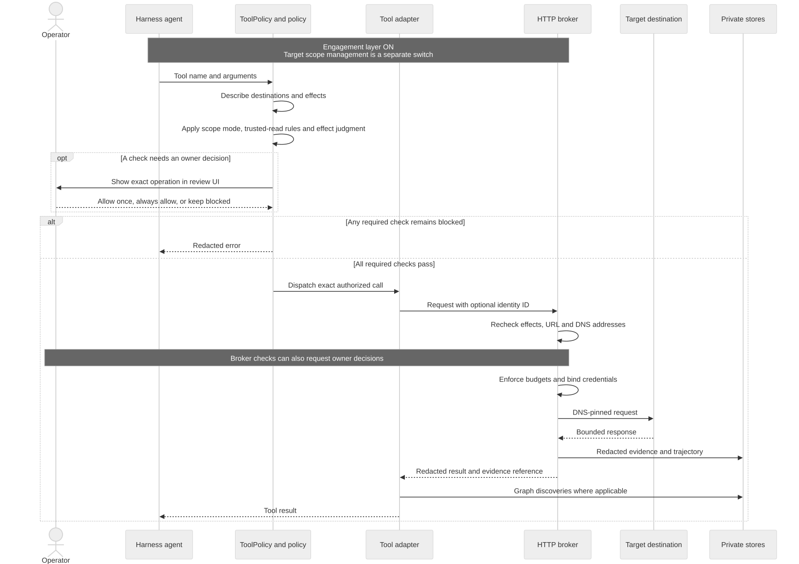

# Djupleita architecture and configuration

Djupleita adds engagement controls, pentest tools, evidence storage and a sidebar to a pinned DeepSeek Harness. Harness supplies the macOS Electron shell, Linux web interface, chat sessions, agent loop, model adapters, subagents and goals. Djupleita composes these through Cordis plugins; its distribution does not replace the shared agent loop.

Use [the edit index](#where-to-make-a-change) to find an implementation, [the instruction map](#where-to-change-instructions) to change agent guidance, and [the configuration flow](#how-startup-and-configuration-work) to understand which settings take effect. Paths are relative to the repository root. Vendor links become available after bootstrap; private `.pentest` paths are described without reading their contents.

## How the components fit together

[](images/components.svg)

[Editable Mermaid source](mermaid/components.mmd)

The owner-controlled engagement switch in [mode.ts](../../packages/dsh-plugin/src/mode.ts) owns the active core's lifetime. With the engagement layer ON, the core owns enforcement and services; optional bundles add tools. Turning the whole layer OFF disposes the core, Pentest tools, persona, review and budgets, leaving ordinary Harness tools and permissions. The switch remains available in Plugins and persists in private `mode.json`. The diagrams show the active engagement path. HTTP-backed actions pass through the broker. Recon CLI tools use their confined proxy path, and REA operates in a confined local workspace. Platform adapters select macOS confinement or Linux Bubblewrap; see the [Linux web guide](../linux.md). Model, intelligence and telemetry traffic have separate destination purposes from target traffic.

Start at [core composition](../../packages/dsh-plugin/src/index.ts), [runtime services](../../packages/dsh-plugin/src/runtime.ts), [bundle inventory](../../configs/distribution.json), [sidebar](../../packages/ui/src/client/Panel.tsx), and [owner channel](../../packages/dsh-plugin/src/rpc.ts).

## How a target request reaches the network

This is the HTTP-backed path. Browser requests and ffuf expansions also reach the broker. Recon CLI proxying and offline REA execution have their own adapters.

[](images/target-request.svg)

[Editable Mermaid source](mermaid/target-request.mmd)

Effect approval and destination approval are separate. Within an active engagement, **Scope management** is a separate switch (`scope.enabled`). When OFF, saved target host/port/path/exclusion/network boundaries are inactive; service destinations, action-effect review, credentials and budgets still apply. When ON, active testing uses target rules and exclusions; bounded HTTP(S) reads can inspect unlisted, non-excluded public sites. URL validation and DNS pinning remain active. See [scope behavior](../scope.md). A reviewed effect does not grant network scope. Redirects receive new checks. Unknown Harness tools have no trusted destination/effect adapter. Red team sends their effects to the selected-model judge by default; the owner can instead choose Allow, Ask for review or Block. Allow skips effect judgment and cannot verify arbitrary shell destinations. Known destructive effects retain their configured review or block. Review decisions belong to the authenticated owner channel; model tools cannot manufacture saved allowances.

Implementations: [tool guard and descriptors](../../packages/dsh-plugin/src/index.ts), [policy and judge prompt](../../packages/policy/src/index.ts), [scope and DNS checks](../../packages/scope/src/index.ts), [review grants](../../packages/dsh-plugin/src/review.ts), [HTTP broker](../../packages/http/src/index.ts), [budgets](../../packages/engagement/src/index.ts), and [identities](../../packages/identities/src/index.ts).

## How startup and configuration work

The default engagement file is `.pentest/engagement.json`. Set `DSH_PENTEST_ENGAGEMENT` before launch to select another engagement file.

[](images/startup-configuration.svg)

[Editable Mermaid source](mermaid/startup-configuration.mmd)

There are three kinds of configuration:

| Kind | Where it lives | How changes take effect |
| --- | --- | --- |
| Distribution defaults | [preset](../../configs/pentest-preset.json), [bundle inventory](../../configs/distribution.json), [engagement template](../../configs/engagement.example.json), [profile materializer](../../scripts/profile.mjs) | Used during profile preparation or initial engagement creation. The engagement template does not overwrite an existing engagement. |
| Saved Harness profile | `.pentest/home/profiles/desktop/cordis.patch.yml` or `profiles/pentest/cordis.patch.yml`, with each profile's `package.json` | Models settings, bundle enablement and custom Cordis rows live here. Restart after profile edits. Desktop and web preview use separate profiles. |
| Saved engagement choices | `.pentest/engagements/ID/settings.json`, `plugins.json` and `mode.json` | Change through Pentest policy/plugin controls. `mode.json` controls whether the whole engagement layer is active; `settings.json` includes the separate scope-management switch. Saved scope/policy and plugin choices take precedence over startup defaults; new managed binary mappings can fill missing entries. **Load local setup** explicitly imports `.pentest/tooling.json`. |

Profile merging matters: [profile-patch.mjs](../../scripts/profile-patch.mjs) refreshes distribution-owned core rows and preserves custom rows, provider settings, comments and expressions. For saved presets, it adds missing plugin IDs and retains matching user choices, including custom base persona text. Existing compaction or delegation entries are not automatically replaced by edits to their checked-in defaults. The migration removes the known legacy Pentest persona suffix from saved base personas so the engagement switch can turn that guidance off. Preparation keeps a private pre-launch backup.

The active Pentest persona comes from [configs/pentest-preset.json](../../configs/pentest-preset.json), `plugins[id=persona].config.prefix`. [applyCore](../../packages/dsh-plugin/src/index.ts) supplies it as required runtime context only while the engagement layer is ON. Base-mode persona configuration lives separately in the selected profile. Rebuild and restart after changing the checked-in persona source; update retained profile entries deliberately when changing other existing preset defaults.

Plugin examples in [configs/plugins.example.json](../../configs/plugins.example.json) document the shape; startup does not load that example automatically. [setup-tools.mjs](../../scripts/setup-tools.mjs) writes local installation configuration. The schemas are [PluginConfigSchema](../../packages/dsh-plugin/src/runtime.ts), [PolicyConfigSchema](../../packages/policy/src/index.ts), and [engagement contracts](../../packages/contracts/src/index.ts).

## Where to change instructions

Repository guidance, the pentest persona, workspace instruction files and effect policy serve different purposes. Choose the layer that owns the behavior you want to change.

[](images/instruction-editing.svg)

[Editable Mermaid source](mermaid/instruction-editing.mmd)

| Instruction layer | Location and scope |
| --- | --- |
| Djupleita contributor rules | [root AGENTS.md](../../AGENTS.md) governs development in this checkout. It is the only `AGENTS.md` currently in the distribution outside the vendor dependency. Read [SECURITY.md](../../SECURITY.md) alongside it. |
| Harness contributor rules | [vendor root AGENTS.md](../../vendor/deepseek-harness/AGENTS.md), then relevant files such as [packages/AGENTS.md](../../vendor/deepseek-harness/packages/AGENTS.md), [packages/client/AGENTS.md](../../vendor/deepseek-harness/packages/client/AGENTS.md), [docs/AGENTS.md](../../vendor/deepseek-harness/docs/AGENTS.md), and [scripts/AGENTS.md](../../vendor/deepseek-harness/scripts/AGENTS.md). The vendor root's `CLAUDE.md` is a symlink to its `AGENTS.md`. Persist vendor changes as reviewed distribution patches. |
| Pentest persona | [configs/pentest-preset.json](../../configs/pentest-preset.json), `plugins[id=persona].config.prefix`; [core composition](../../packages/dsh-plugin/src/index.ts) injects it while the engagement layer is ON. Saved profile personas remain the base-mode guidance. |
| Djupleita home guidance | `.pentest/home/AGENTS.md`, if created. The launchers set `DSH_HOME` to this private home, so the ordinary Harness default `~/.dsh/AGENTS.md` is not its home instruction file. |
| Shared user guidance | `$DSH_AGENTS_HOME/AGENTS.md`, or `~/.agents/AGENTS.md` by default. Both launchers inherit `DSH_AGENTS_HOME`; they do not redirect it into `.pentest`. This can affect other Harness installations that use the same shared root. |
| Workspace guidance | `AGENTS.md`, `CLAUDE.md`, `AGENTS.local.md`, `CLAUDE.local.md` in the active chat workspace and relevant ancestor/nested directories. The active chat's working directory determines applicability. |
| Bundled workflow skills | [assessment](../../skills/djupleita-assessment/SKILL.md), [readiness](../../skills/djupleita-readiness/SKILL.md), [coverage](../../skills/djupleita-coverage/SKILL.md), [proof](../../skills/djupleita-proof/SKILL.md), and [report](../../skills/djupleita-report/SKILL.md). [skills.ts](../../packages/dsh-plugin/src/skills.ts) registers their catalog, `pentest_skill` loader and required workflow reminder through the assessment bundle. |
| Learned advisory procedure | Owner-promoted procedure in private engagement `settings.json`; [core composition](../../packages/dsh-plugin/src/index.ts) contributes it as required runtime context. Learning code and dataset schemas live in [packages/learning](../../packages/learning/src/index.ts) and [schema.ts](../../packages/learning/src/schema.ts). Promotion does not grant scope or tool permission. |
| Effect judge instructions | The selected-model judgment prompt in [packages/policy/src/index.ts](../../packages/policy/src/index.ts). Scope, local rules and review remain enforced in code. |

Files under vendor `snapshots/session/**/workspace` are fixtures. [apps/cli/tests/profiles/AGENTS.md](../../vendor/deepseek-harness/apps/cli/tests/profiles/AGENTS.md) contains contributor rules for profile integration tests. Neither location is the live user-global configuration. Edit the loader and its tests when changing instruction discovery.

### How Harness finds workspace instructions

The following is the pinned Harness loader's behavior, rather than a description of how every external coding assistant interprets `AGENTS.md`.

[](images/instruction-loading.svg)

[Editable Mermaid source](mermaid/instruction-loading.mmd)

Existing candidate files load in broad-to-specific order; trimmed-content duplicates in the same candidate group collapse. More specific workspace guidance takes precedence over broader guidance while remaining below system, developer and direct user instructions. The two global files share a deduplication group. The base bundle budgets each chain at 65,536 bytes; broader files are omitted before the most specific retained file is truncated.

There is no continuous file watcher. Successful first-party filesystem tools drive refresh; changing the session working directory and resuming also reconcile instructions. Shell `cd` alone does not discover nested guidance. A `.agents/AGENTS.md` inside a workspace is an ordinary nested project candidate, not an automatically selected shared home.

Read the [loader reference](../../vendor/deepseek-harness/packages/context/agent-instructions/README.md), [configuration](../../vendor/deepseek-harness/packages/context/agent-instructions/src/config.ts), [discovery](../../vendor/deepseek-harness/packages/context/agent-instructions/src/files.ts), and [base bundle](../../vendor/deepseek-harness/packages/bundle/base/cordis.patch.yml). Broader prompt assembly lives in [core/system-prompt](../../vendor/deepseek-harness/packages/core/system-prompt/README.md); the preset persona contributor lives in [preset/persona](../../vendor/deepseek-harness/packages/preset/persona/src/index.ts).

### Find the instruction files

Run from the repository root. `--hidden --no-ignore` includes the ignored Harness checkout and dot directories. These commands print filenames, not instruction or credential contents.

```sh
# Main contributor guidance, omitting snapshots and test trees.
rg --files --hidden --no-ignore \
  -g 'AGENTS.md' -g 'CLAUDE.md' \
  -g 'AGENTS.local.md' -g 'CLAUDE.local.md' \
  -g '!**/node_modules/**' -g '!**/.git/**' -g '!**/.pentest/**' \
  -g '!**/snapshots/**' -g '!**/tests/**' \
  -g '!**/.artifacts/**' -g '!**/.dsh-build/**'

# Include fixture instructions when investigating the loader's tests.
rg --files --hidden --no-ignore vendor/deepseek-harness \
  -g 'AGENTS.md' -g 'CLAUDE.md' \
  -g 'AGENTS.local.md' -g 'CLAUDE.local.md' \
  -g '!**/node_modules/**' -g '!**/.git/**'

# Locate persona, prompt contributions and instruction loader composition.
rg -n 'persona|systemPrompt|agent-instructions' \
  configs/pentest-preset.json packages/dsh-plugin/src \
  vendor/deepseek-harness/packages/bundle/base/cordis.patch.yml
```

For an arbitrary chat workspace, run the first search from that workspace and inspect its ancestor chain. Check the two configured global-home paths separately; a repository search cannot discover files outside the checkout.

## How subagents and goals interact

[](images/subagents-goals.svg)

[Editable Mermaid source](mermaid/subagents-goals.mmd)

The preset exposes delegation and goal tools; the base Harness bundle supplies their host services. Children inherit enforcement and do not acquire extra target authority by delegation. Goals stop on completion, blocking, cancellation, errors or the round cap. Restarted/restored chats require explicit `/goal resume`; the app does not continue work while closed.

Change tool exposure in [the pentest preset](../../configs/pentest-preset.json), effect descriptors for Harness controls in [dsh-plugin](../../packages/dsh-plugin/src/index.ts), and upstream implementations under [subagent](../../vendor/deepseek-harness/packages/subagent/README.md) and [goal](../../vendor/deepseek-harness/packages/goal/README.md). Focused coverage lives in [orchestration.test.ts](../../tests/orchestration.test.ts) and [compaction.test.ts](../../tests/compaction.test.ts).

## Where private state and audit records go

[](images/storage-audit.svg)

[Editable Mermaid source](mermaid/storage-audit.mmd)

The optional exporter starts disabled. Course mode adds ordered fragment delivery and digest-compatible records; the receiver validates authorization and reconstructed digests before committing records. Generic OTLP and course mode are different payload paths. The in-process sender exports redacted copies and does not isolate records from a compromised local app process.

| Private location | Purpose |
| --- | --- |
| `.pentest/home/.credentials.yaml` | Harness model credentials; separate from target identity secrets in macOS Keychain or Linux Secret Service. |
| `.pentest/home/profiles/` | Harness profiles, provider definitions and saved composition. |
| `.pentest/engagement.json` | Default selected engagement definition, including initial scope and budgets. |
| `.pentest/engagements/ID/settings.json` | Saved scope, effect policy, ranking and any promoted advisory procedure. |
| `.pentest/engagements/ID/plugins.json` | Saved engagement plugin configuration. |
| `.pentest/engagements/ID/grants.json` | Owner-saved operation allowances and exact host/IP destination grants. Operation grants depend on configuration revision; destination grants survive revisions until revoked. |
| `.pentest/engagements/ID/mode.json` | Persistent owner choice for the whole engagement layer; separate from `scope.enabled`. |
| `.pentest/engagements/ID/preferences.json` | Saved setup-reminder dismissal. |
| `.pentest/engagements/ID/identities.json` | Identity metadata and secret references. |
| `.pentest/engagements/ID/graph.sqlite`, `blobs/`, `trajectories/` | Evidence graph, redacted evidence blobs and hash-linked chat trajectories. |
| `.pentest/engagements/ID/assessment.sqlite` | Assessment runs, coverage, leads, assertions, finding review and durable budget state. |
| `.pentest/engagements/ID/browser`, `recon`, `ffuf`, `rea`, `studies`, `outbox` | Private browser state, workspaces, learning artifacts and export queue. |
| `.pentest/engagements/ID/writer.lock` | Prevents multiple desktop/preview writers for one engagement. |
| `.pentest/toolchains/` and `.pentest/tooling.json` | Managed dependency installations and their local configuration. |

See [trajectory storage](../../packages/trajectory/src/index.ts), [exporter](../../packages/export/src/index.ts), and [course receiver guide](../../course/audit-stream/README.md). Receiver changes must preserve seat/course authorization, digest verification, immutable custody, the board, seat listing and operator publishing. Cloudflare deployment requires an explicit request.

## Where to make a change

| If you want to change… | Start here | Relevant verification |
| --- | --- | --- |
| Contributor instructions and publication rules | [AGENTS.md](../../AGENTS.md), [SECURITY.md](../../SECURITY.md), [security scanner](../../scripts/security/scan.mjs), [.githooks](../../.githooks) | Secret checks; `pnpm security:test` for scanner changes. |
| Pentest persona, exposed delegation/goal tools or compaction defaults | [pentest-preset.json](../../configs/pentest-preset.json), [runtime persona contribution](../../packages/dsh-plugin/src/index.ts); check saved profile entries for retained delegation/compaction defaults | [profile](../../tests/profile.test.ts), [orchestration](../../tests/orchestration.test.ts), [compaction](../../tests/compaction.test.ts). |
| Included bundle cards and package composition | [distribution.json](../../configs/distribution.json), [plugin bundle patches](../../packages/plugin-http/cordis.patch.yml), [profile.mjs](../../scripts/profile.mjs) | [profile](../../tests/profile.test.ts), [desktop snapshot](../../tests/desktop-snapshot.test.ts). |
| Tool registration, schemas and trusted effect descriptions | [dsh-plugin/src/index.ts](../../packages/dsh-plugin/src/index.ts), [entry points](../../packages/dsh-plugin/src/entries/core.ts), [contracts](../../packages/contracts/src/index.ts) | [integration](../../packages/dsh-plugin/src/integration.test.ts), [review](../../tests/review.test.ts), affected tool tests. |
| Engagement on/off switch | [mode.ts](../../packages/dsh-plugin/src/mode.ts), [core entry](../../packages/dsh-plugin/src/entries/core.ts), [sidebar](../../packages/ui/src/client/Panel.tsx) | [mode lifetime](../../packages/dsh-plugin/src/mode.test.ts); exercise both platforms' owner controls. |
| Service composition and engagement restore behavior | [runtime.ts](../../packages/dsh-plugin/src/runtime.ts), [engagement](../../packages/engagement/src/index.ts) | [integration](../../packages/dsh-plugin/src/integration.test.ts), [profile](../../tests/profile.test.ts). |
| Scope, DNS restrictions, effects or saved allowances | [scope](../../packages/scope/src/index.ts), [policy](../../packages/policy/src/index.ts), [review.ts](../../packages/dsh-plugin/src/review.ts) | [scope](../../tests/scope.test.ts), [policy](../../tests/policy.test.ts), [review](../../tests/review.test.ts), [model egress](../../tests/model-egress.test.ts). |
| HTTP transport or credential delivery | [http](../../packages/http/src/index.ts), [identities](../../packages/identities/src/index.ts), [Keychain helper](../../native/keychain-helper.swift), [Linux secure store](../../packages/identities/src/index.ts) | [HTTP](../../tests/http.test.ts), [Keychain](../../tests/keychain.test.ts), [model egress](../../tests/model-egress.test.ts). |
| Browser, crawl or A/B authorization testing | [browser](../../packages/browser/src/index.ts), [crawl](../../packages/crawl/src/index.ts), [authz](../../packages/authz/src/index.ts) | [browser](../../tests/browser.test.ts), [crawl/authz](../../tests/crawl-authz.test.ts). |
| Recon, passive APIs or ffuf | [recon](../../packages/recon/src/index.ts), [passive recon](../../packages/recon/src/passive.ts), [fuzz](../../packages/fuzz/src/index.ts), [worker confinement](../../packages/worker/src/index.ts) | [passive](../../tests/passive.test.ts), [fuzz](../../tests/fuzz.test.ts), [worker](../../tests/worker.test.ts), tool setup tests. |
| REA integration and local analysis | [rea](../../packages/rea/src/index.ts), [macOS adapter](../../packages/rea/src/macos.ts), [worker platform adapters](../../packages/worker/src/platform.ts), [REA bundle guide](../../packages/plugin-rea/README.md) | [REA](../../tests/rea.test.ts), [REA setup](../../tests/rea-setup.test.ts). |
| Evidence, graph queries or trajectory inspection | [graph](../../packages/graph/src/index.ts), [trajectory](../../packages/trajectory/src/index.ts), [inspection.ts](../../packages/dsh-plugin/src/inspection.ts) | [graph](../../tests/graph.test.ts), [trajectory](../../tests/trajectory.test.ts), [inspection](../../tests/inspection.test.ts). |
| Learning datasets, ranking or advisory procedures | [learning](../../packages/learning/src/index.ts), [schemas](../../packages/learning/src/schema.ts), [Python optimizers](../../packages/learning/python/optimize.py), [example datasets](../../configs/datasets/lab-ranking.json) | [learning](../../tests/learning.test.ts); use synthetic offline fixtures. |
| Assessment workflow instructions, readiness or finding proofs | [bundled skills](../../skills/djupleita-assessment/SKILL.md), [skill registry](../../packages/dsh-plugin/src/skills.ts), [assessment tools](../../packages/dsh-plugin/src/assessment.ts), [assessment service](../../packages/assessment/src/index.ts), [owner assertions/review RPC](../../packages/dsh-plugin/src/assessment-rpc.ts) | Focused assessment coverage, broker integration and owner review checks; keep fixtures synthetic. |
| Sidebar, forms, review cards or polling | [Panel.tsx](../../packages/ui/src/client/Panel.tsx), [styles](../../packages/ui/src/client/Panel.module.css), [polling](../../packages/ui/src/client/polling.ts), [reviews](../../packages/ui/src/client/reviews.ts), [owner RPC](../../packages/dsh-plugin/src/rpc.ts) | [UI polling](../../tests/ui-polling.test.ts), [UI reviews](../../tests/ui-reviews.test.ts), [desktop snapshot](../../tests/desktop-snapshot.test.ts). |
| Tool installation, versions or checksums | [setup-tools.mjs](../../scripts/setup-tools.mjs), [UI setup](../../packages/dsh-plugin/src/setup.ts), [recon lock](../../configs/recon-tools.lock.json), [ffuf lock](../../configs/ffuf.lock.json), [REA Node lock](../../configs/rea-node.lock.json) | [toolchain setup](../../tests/toolchain-setup.test.ts), [ffuf setup](../../tests/ffuf-setup.test.ts), [REA setup](../../tests/rea-setup.test.ts). |
| Provider import or profile preservation | [provider-import.mjs](../../scripts/provider-import.mjs), [profile-patch.mjs](../../scripts/profile-patch.mjs) | [provider import](../../tests/provider-import.test.ts), [profile](../../tests/profile.test.ts). |
| Telemetry or the course receiver | [export](../../packages/export/src/index.ts), [worker entry](../../course/audit-stream/worker/src/index.ts), [receiver guide](../../course/audit-stream/README.md) | [export](../../tests/export.test.ts), [course audit](../../tests/course-audit.test.ts); worker `npm test` and `npm run typecheck` for receiver changes. |
| Harness shell, shared agent loop or instruction loader | [upstream.lock.json](../../upstream.lock.json), [patches](../../patches), [agent loop](../../vendor/deepseek-harness/packages/core/agent-loop/src/index.ts), [instruction loader](../../vendor/deepseek-harness/packages/context/agent-instructions/src/index.ts) | Persist reviewed patches; bootstrap verifies the pinned commit before overlays. Run focused upstream/distribution coverage for the changed behavior. |

For distribution code changes, validate the affected behavior on macOS desktop and Linux web using local fixtures. UI or Harness changes also require authenticated Linux web startup and browser workflow checks. Run `pnpm typecheck`, `pnpm build` and the affected Vitest files as required by [AGENTS.md](../../AGENTS.md). Verification uses local fixtures rather than real model calls or target scans. Private state, credentials, engagement data and runtime screenshots stay out of source control; install the scanner/hooks described in [SECURITY.md](../../SECURITY.md) before committing.

## Diagram sources and regeneration

This folder keeps the guide, editable Mermaid sources and rendered vector images together:

```text
docs/architecture/
├── README.md          # Guide and links to implementation files
├── mermaid/           # Seven editable .mmd source files
├── images/            # Seven rendered .svg diagrams
└── render.mjs         # Local renderer using pinned workspace dependencies
```

Edit the matching file under `mermaid/`, then regenerate the SVG images from the repository root:

```sh
node docs/architecture/render.mjs
```

The renderer uses Mermaid from the pinned Harness website dependencies and Playwright from the distribution. Install both workspaces as described in the [root README](../../README.md), and ensure the matching Playwright Chromium is installed. If Chromium was installed with `pnpm setup:tools --only browser`, select that managed installation:

```sh
PLAYWRIGHT_BROWSERS_PATH="$PWD/.pentest/toolchains/browser" \
  node docs/architecture/render.mjs
```

Rendering uses an isolated headless browser with page network requests blocked. SVG labels use native text so the images work in ordinary Markdown viewers. The renderer supports macOS and Linux; generated files can differ slightly with the installed fonts. Optional PNG previews for local visual review can be written outside the checkout:

```sh
node docs/architecture/render.mjs --preview-dir /tmp/djupleita-architecture-preview
```

Visually review changed diagrams and run the secret guard before publication. App screenshots follow the separate `docs/images/` rules in [SECURITY.md](../../SECURITY.md).
